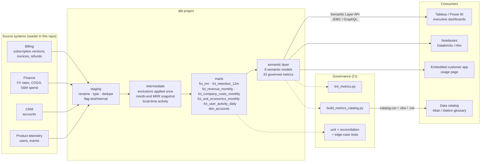

# Architecture

## Layers

## Where each kind of logic lives

| Logic | Layer | Why there |
|---|---|---|
| Renaming, typing, deduplication, flagging test/internal records | staging | Source-shaped and reversible, so nothing is thrown away yet |
| Exclusions (test accounts, internal users, passive events) | intermediate | Applied **once**. Every mart inherits them, so no dashboard can forget a filter (MLR-010) |
| Month-end snapshot, FX policy, ratable revenue, movement classification | marts | Needs window functions and history that a semantic layer should not re-derive on every query |
| Trailing-window ratios (LTV, LTV:CAC) | marts | Not a ratio of additive measures. Exposed as point-in-time measures |
| Aggregation, ratios, derived metrics, time grains, dimension joins | semantic layer | Defined once. Correct at any grain, sliceable by any conformed dimension |
| Presentation (colours, layout, targets) | BI tools | The only logic BI tools are allowed to hold |

## Key semantic-layer design choices

**Semi-additive balances.** MRR, ARR, customer counts, retention bases, LTV and LTV:CAC
use `non_additive_dimension` with `window_choice: max`, so a quarter or year query returns
the period-end balance instead of adding three months together. Flows (new MRR, churned MRR,
revenue, spend) stay fully additive.

**Ratios built from additive parts.** `logo_churn_rate`, `arpa`, `nrr`, `grr` are `ratio`
metrics, and `cac`, `cac_payback_months`, `gross_margin_pct` are `derived`. MetricFlow
aggregates the numerator and denominator at the requested grain and then divides. A quarter's
CAC is quarter spend divided by quarter new logos, never the average of three monthly CACs.

**One conformed account dimension.** Facts carry only the `account` foreign entity.
Segment, region, channel and currency come from `dim_accounts`, so "churn by segment" and
"NRR by segment" can't disagree about which segment an account is in.

**Cumulative MAU.** `mau` is a cumulative metric (28-day window, `period_agg: last`) on a
`count_distinct` measure. Slicing by `account__segment` gives deduplicated users per segment,
which a pre-aggregated table cannot do.

**Cross-database SQL.** Models use dbt cross-database macros (`dateadd`, `datediff`,
`date_trunc`, `date_spine`). Time-zone conversion is a dispatched macro with Postgres/DuckDB,
Snowflake and Databricks implementations. Postgres is the reference adapter in CI.

## Test strategy

| Test type | Count | Examples |
|---|---|---|
| Generic data tests | 50+ | `unique`, `not_null`, `accepted_values`, `relationships`, `accepted_range`, `expression_is_true` |
| Reconciliation (singular) | 3 | MRR waterfall closes every month. Customer roll-forward closes. MRR equals the contract roll-up. |
| Edge-case (singular) | 9 | FX never booked as movement. Local-date fixtures. Passive events. CAC excludes CS. Closed months only. |
| Unit tests | 2 | Movement classification across a fiscal-year FX reset. Month-end boundary behaviour. |

The reconciliation tests matter most. If the waterfall doesn't close, some movement is
being lost or counted twice, and every downstream retention number is suspect.
